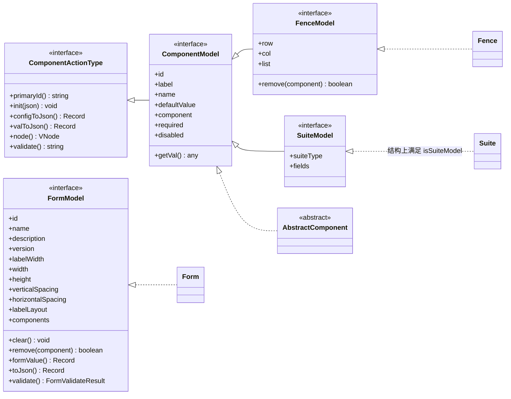
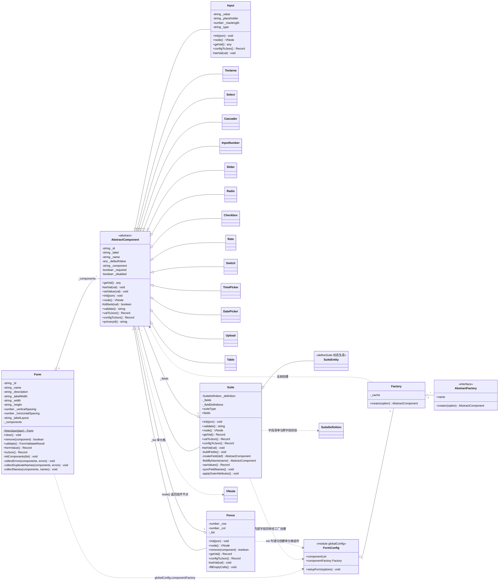
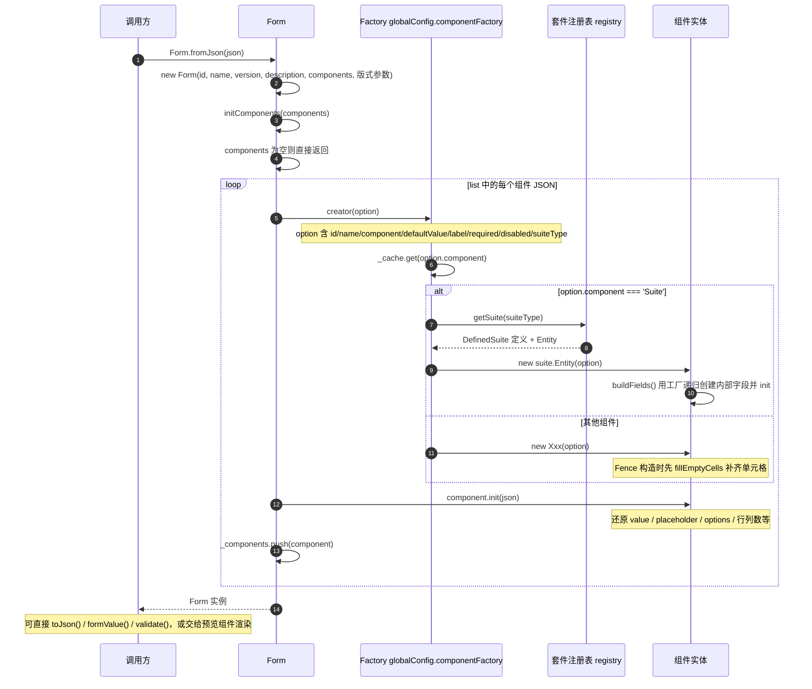
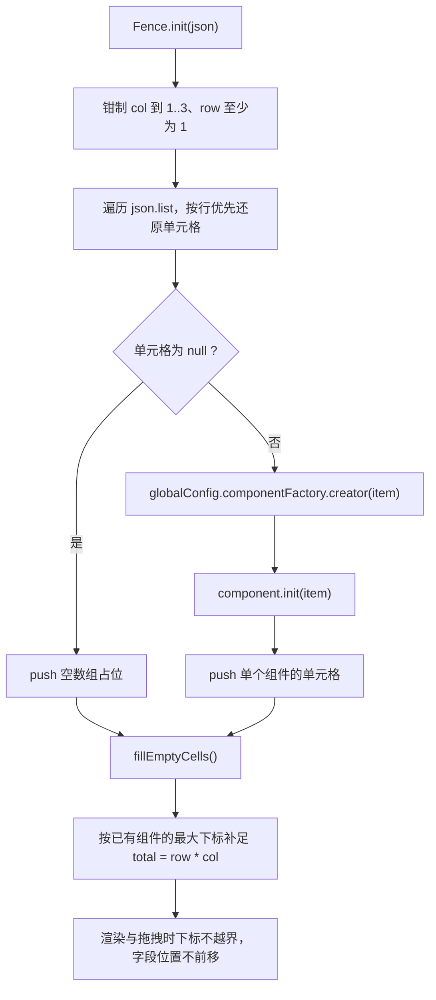
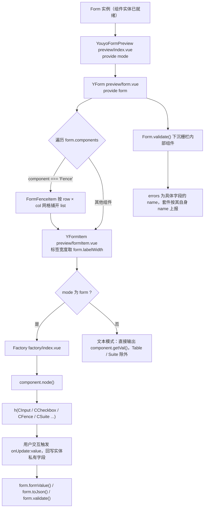
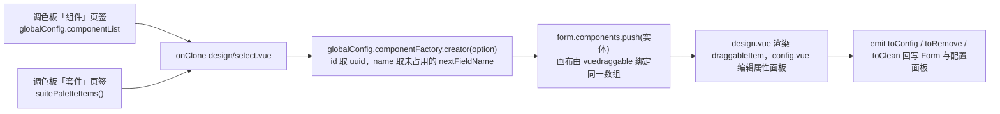

# 动态表单（youyo-form）类图与加载流程

本文用 Mermaid 描述 `youyo-form` 的静态结构与运行时加载链路，VS Code / GitHub 可直接预览。
图只画主干，精确类型以 [src/core/types.ts](../src/core/types.ts) 为准。

> 安装、设计器/预览用法、自定义组件与套件见 [usage.md](./usage.md)。

- [1. 类图](#1-类图)
- [2. 加载流程：从 JSON 还原为可渲染的表单](#2-加载流程从-json-还原为可渲染的表单)
- [3. 加载后的渲染与取值链路](#3-加载后的渲染与取值链路)
- [4. 设计器侧的组件创建链路](#4-设计器侧的组件创建链路)

## 1. 类图

类图拆成两张：**1.1 看「谁实现哪个接口」**，**1.2 看「实体的成员、继承与组合」**。

### 1.1 接口与实现关系

`AbstractComponent` 是**唯一直接实现 `ComponentModel` 的类**（`implements ComponentModel`），也是所有组件实体的共同父类；`Form` / `Fence` / `Suite` 各自实现更宽的结构化类型。其中 `Fence` 显式 `implements FenceModel`，`Suite` 没有写 `implements`，而是靠成员结构满足 `SuiteModel`，因此对外用 `isSuiteModel()` 守卫判断。

代码中这些位置的引用类型都是 `ComponentModel`，运行时实现统一是 `AbstractComponent` 的子类：`Form.components`、`Fence.list`、`Suite.fields`、渲染组件收到的 `component` prop。

### 1.2 实体类的继承与成员

接口实现关系见 1.1；本图只画实体自身的成员，以及实体之间的继承、组合与工厂依赖。

### 1.3 关键成员类型对照

| 类 | 成员 | 实际类型 | 说明 |
| --- | --- | --- | --- |
| `AbstractComponent` | `_defaultValue` | `any` | setter 会调用 `setVal()`，容器类组件据此回填内部字段 |
| `AbstractComponent` | `validate()` | `string \| undefined` | 必填且 `isBlank()` 为真时返回错误信息 |
| `Fence` | `_list` | `Array<Array<AbstractComponent>>` | 按行优先排列，空单元格为空数组 |
| `Suite` | `_fields` | `Array<AbstractComponent>` | 与 `_fieldDefinitions` 下标一一对应 |
| `Suite` | `_fieldDefinitions` | `SuiteFieldDefinition[]` | 来自 `_definition.fields`，是字段清单的唯一来源 |
| `Form` | `_components` | `Array<AbstractComponent>` | 顶层组件，`components` 为只读视图 |
| `Form` | `labelLayout` | `'horizontal' \| 'vertical'` | 标签与组件的排列方式 |
| `Factory` | `_cache` | `Map<string, AbstractFactory>` | key 为组件的 `component` |
| `FormConfig` | `componentList` | `ComponentSelectType[]` | 设计器「组件」页签的数据源 |

### 1.4 注册关系

- **组件**：`config.ts` 的 `factories` 声明 `component → creator`，`componentList` 声明调色板条目，两者 key 都是 `component`。
- **套件**：`defineSuite()` 生成实体类并写入注册表，`config.ts` 里 `Suite` 的 creator 通过 `getSuite(suiteType)` 取到 `Entity` 再 `new`；`suitePaletteItems()` 用同一份注册表生成调色板条目。
- 内置套件通过 `config.ts` 顶部的 `import './suites'` 在模块加载时完成注册。

## 2. 加载流程：从 JSON 还原为可渲染的表单

`Form` 构造与 `Form.fromJson()` 走同一条链路：先由工厂造出实体，再交给实体自己的 `init()` 还原字段。

栅栏的内部加载是递归的，单独看一遍：

## 3. 加载后的渲染与取值链路

## 4. 设计器侧的组件创建链路

设计器拖拽产生组件的路径与加载同源，都汇聚到 `Factory.creator()`：

## 5. 相关源码

| 关注点 | 文件 |
| --- | --- |
| 类型定义与守卫 | [src/core/types.ts](../src/core/types.ts) |
| 表单实体与校验 | [src/core/Form.ts](../src/core/Form.ts) |
| 组件基类 | [src/core/AbstractComponent.ts](../src/core/AbstractComponent.ts) |
| 抽象工厂 | [src/core/Factory.ts](../src/core/Factory.ts) |
| 组件实体 | [src/core/entity/](../src/core/entity/) |
| 套件基类与注册表 | [src/core/suite/Suite.ts](../src/core/suite/Suite.ts)、[src/core/suite/index.ts](../src/core/suite/index.ts) |
| 工厂与调色板注册 | [src/config.ts](../src/config.ts) |
| 预览渲染 | [src/preview/](../src/preview/) |
| 设计器 | [src/design/](../src/design/) |
